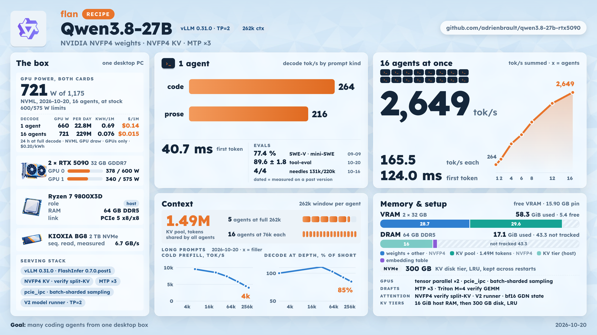
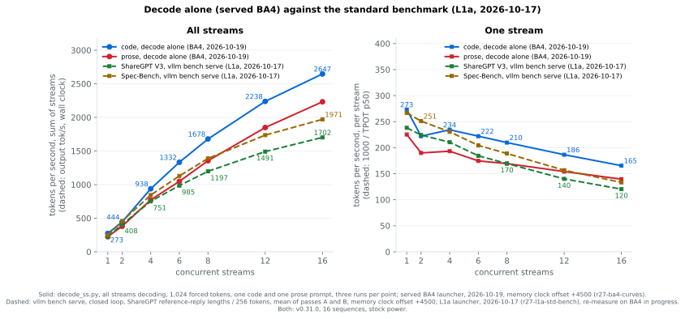
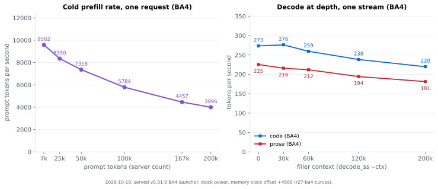
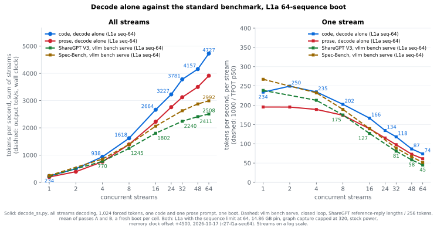

# Qwen3.8-27B on RTX 5090



Serving configuration, vLLM patches, launch scripts and measurements for [Qwen3.8-27B](https://huggingface.co/Qwen/Qwen3.8-27B), served as [nvidia/Qwen3.8-27B-NVFP4](https://huggingface.co/nvidia/Qwen3.8-27B-NVFP4) by [vLLM](https://github.com/vllm-project/vllm) v0.31.0 with the patch chain in [patches-v0310/](patches-v0310/) and FlashInfer 0.7.0.post1 across two RTX 5090 cards. The window is 262,144 tokens, the KV cache is NVFP4, the checkpoint's own MTP head drafts 3 tokens, and vision, reasoning, tool calls and structured output are all on. The target workload is a few concurrent coding agents with long contexts. The one-card and older shapes are under [Other configurations](#other-configurations).

Measurements come from one machine on the dates given, with write-ups naming their raw results directories; capacity arithmetic states its measured inputs. The index of experiments is [bench/RESULTS.md](bench/RESULTS.md), newest first.

## Numbers

Measured on the served launcher [scripts/serve-v031-served-daily.sh](scripts/serve-v031-served-daily.sh), image `vllm-qwen38:v0310-r27c-A_S-BA4-L1a-ubplan`, at stock power limits of 600 / 575 W (the serving host caps both at 400 W), on 2026-10-20 ([r27-served-curves](bench/results/r27-served-curves.md), results `2026-10-20-141816-r27-served-curves`; [r27-served-std-bench](bench/results/r27-served-std-bench.md), results `2026-10-20-r27-served-std-bench-1418`). [decode_ss.py](scripts/decode_ss.py) runs synchronized code and prose streams at temperature 0.6 with 1,024 forced tokens, three runs per shape; `vllm bench serve` measures closed-loop requests over two passes. Decode rate is tokens per second per stream while every stream is decoding; decode aggregate is the sum over the concurrent streams. Method: [How the numbers are measured](#how-the-numbers-are-measured).



Solid lines are decode alone, blue code and red prose: decode aggregate on the left, the rate of each stream on the right. Dashed lines are `vllm bench serve` on ShareGPT V3 (green, 0 % cached) and Spec-Bench (brown; 2.19 % of its prompt tokens came from the disk tier in 13 of 14 cells, [r27-served-std-bench](bench/results/r27-served-std-bench.md)): wall-clock output tok/s on the left, 1000 / TPOT p50 per stream on the right.

- One stream decodes 263.9 t/s of code and 215.9 of prose.
- At the 16-sequence limit the aggregate is 2,648.6 t/s of code and 2,239.7 of prose, 165.5 and 140.0 per stream.
- The MTP head gets 0.61 to 0.68 of its draft tokens accepted on code and 0.46 to 0.49 on prose.
- Under `vllm bench serve` at 16 streams, ShareGPT V3 reads 1,649.9 wall-clock output tok/s and 115.7 per stream; Spec-Bench reads 1,925.1 wall-clock output tok/s and 130.3 per stream (2.19 % tier-cached prompt tokens).
- Pool arithmetic gives 5 agents at the full 262,144-token window, or about 75,568 tokens each at 16 agents, after the per-request GDN state cost ([r27-kv-pin](bench/results/r27-kv-pin.md), 2026-10-20 pool from results `2026-10-20-135353-pin-promote`, using R200's 2026-09-05 state measurement).



Cold prefill runs at 9,557 t/s at 6.7K prompt tokens and 3,994 at 200K. One code stream decodes 271.5 t/s at a 60K filler budget and 224.1 at 200K.

| | value | source |
|---|---|---|
| context window | 262,144 tokens | 2026-10-20, [r27-served-curves](bench/results/r27-served-curves.md) |
| decode, 1 stream, code / prose | 263.9 / 215.9 t/s | 2026-10-20, [r27-served-curves](bench/results/r27-served-curves.md) |
| decode aggregate, 16 streams, code / prose | 2,648.6 / 2,239.7 t/s | 2026-10-20, [r27-served-curves](bench/results/r27-served-curves.md) |
| KV pool on the GPUs | 1,490,437 tokens, NVFP4, 15.90 GB per card, 16 sequences | 2026-10-20, [r27-served-curves](bench/results/r27-served-curves.md) |
| free VRAM after the launcher's pre-warm | 2,757 / 2,757 MiB | 2026-10-20, [r27-served-curves](bench/results/r27-served-curves.md) |
| time to first token, cold prompt | 0.70 / 2.93 / 17.27 / 50.10 s at 6.7K / 25K / 100K / 200K tokens | 2026-10-20, [r27-served-curves](bench/results/r27-served-curves.md) |
| KV tiers behind the pool | 16 GiB host RAM, then 300 GB of disk with LRU eviction, kept across restarts | 2026-10-20, [r27-served-curves](bench/results/r27-served-curves.md) |
| `vllm bench serve`, 16 streams, wall-clock output | 1,649.9 tok/s on ShareGPT V3; 1,925.1 on Spec-Bench (2.19 % tier cached) | 2026-10-20, [r27-served-std-bench](bench/results/r27-served-std-bench.md) |
| `vllm bench serve`, 16 streams, TTFT p50 / p99 | 124.0 / 500.3 ms on ShareGPT V3; 127.2 / 285.6 ms on Spec-Bench (2.19 % tier cached) | 2026-10-20, [r27-served-std-bench](bench/results/r27-served-std-bench.md) |

Also on the served configuration (2026-10-20, [r27 served quality](bench/results/r27-served-quality.md), results `2026-10-20-172512-r27-served-quality` and `2026-10-20-173445-r27-served-quality`): tool-eval 89.6 ± 1.8 over 8 trials of 69 scenarios, GSM8K 5-shot T=0 0.895 over 200 problems; tool smoke 5 of 5 ([r27-kv-pin](bench/results/r27-kv-pin.md), results `2026-10-20-135353-pin-promote`).

## Served configuration

- Weights [nvidia/Qwen3.8-27B-NVFP4](https://huggingface.co/nvidia/Qwen3.8-27B-NVFP4), image `vllm-qwen38:v0310-r27c-A_S-BA4-L1a-ubplan` (vLLM v0.31.0, [patches-v0310/](patches-v0310/), FlashInfer 0.7.0.post1), port 8020. The served launcher is [scripts/serve-v031-served-daily.sh](scripts/serve-v031-served-daily.sh); [scripts/serve.sh](scripts/serve.sh) starts the same engine with the host paths as settings. Promotions and rollbacks: [docs/HISTORY.md](docs/HISTORY.md); every flag: [docs/CONFIG.md](docs/CONFIG.md).
- Tensor parallel 2, 16 sequences, 262,144-token window, NVFP4 KV pinned at 15.90 GB per card (`--kv-cache-memory-bytes`, 1,490,437 tokens; 2026-10-20, [r27-served-curves](bench/results/r27-served-curves.md)), linear-attention state cached in bf16.
- The checkpoint's MTP head at 3 draft tokens (`qwen3_5_mtp`), with L1a's CPU upper-bound plan for pure draft decode (`VLLM_SM12X_DRAFT_UB_PLAN=1`).
- `"disable_eagle_block_drop":true` in the speculative config: a prefix-cache hit keeps its last full-attention block instead of re-prefilling it ([r27 no block drop](bench/results/r27-no-block-drop.md)).
- The bf16 M=4 `in_proj_ba` call of the 48 GDN layers on the MTP verify step runs on a Triton GEMM (BA4, `VLLM_SM12X_BA_M4=1`), admitted per card from admission reports measured on the serving host's cards; a layer whose report does not match the device, code or weights keeps the original GEMM.
- FlashInfer's `pcie_ipc` all-reduce as the two-card decode all-reduce (patch 0138, `VLLM_SM12X_PCIE_IPC_AR=1`; patch 0148 admits the MTP head to it) and batch-sharded sampling (`--enable-batch-sharded-sampling`, patch 0147).
- KV tiers: 16 GiB of pinned host RAM, then a 300 GB disk tier with LRU eviction and a 40 GB free-space floor.
- FlashInfer's split-KV path for the MTP verify attention on the NVFP4 cache (patch 0136, `VLLM_SM12X_NVFP4_PREFILL_SPLIT_KV=1`), vLLM's V2 model runner (`VLLM_USE_V2_MODEL_RUNNER=1`), and the Triton Mamba backend with FlashInfer GDN prefill (`--mamba-backend triton --gdn-prefill-backend flashinfer`).

## What the stack is

- **Weights**: [nvidia/Qwen3.8-27B-NVFP4](https://huggingface.co/nvidia/Qwen3.8-27B-NVFP4), a ModelOpt 0.47.0.dev80 checkpoint: NVFP4 group-16 on all 64 MLP layers, an NVFP4 `lm_head`, and an input scale on all 401 quantized layers, so activations are quantized too (W4A4). It declares no KV quantization; the KV dtype is the launcher's. The bf16 rulers are in [docs/FIDELITY.md](docs/FIDELITY.md).
- **Engine**: [vLLM v0.31.0](https://github.com/vllm-project/vllm/releases) with the [patches-v0310/](patches-v0310/) chain (0101 to 0162; [PORT-STATUS.md](patches-v0310/PORT-STATUS.md) says what each v0.29 patch became).
  - NVFP4 KV on `sm_120`, which upstream gates to SM100.
  - A pooled FlashInfer workspace, prefix-cache reuse under speculative decoding, the embedding table in pinned host RAM.
  - LRU eviction for the disk tier, which upstream lacks.
  - FlashInfer main's `pcie_ipc` all-reduce as the two-card decode all-reduce, vendored as patch 0138 behind `VLLM_SM12X_PCIE_IPC_AR=1` and asserted at boot ([R185](bench/results/r185-pcie-ipc-all-reduce.md)); patch 0148 admits the MTP head to it.
  - The prefix cache and the offload tiers hit under the MTP head, including the linear-attention state blocks: 0152, 0155, 0156 and the 0158 replay boundary are upstream in v0.31.0, 0154 is carried as a patch ([THIRD_PARTY.md](THIRD_PARTY.md)).
  - [FlashInfer](https://github.com/flashinfer-ai/flashinfer) 0.7.0.post1, the version vLLM v0.31.0 pins, with patch 0136 turning back on the split-KV path that FlashInfer 0.7 turns off for an NVFP4 KV cache on SM12x ([r27](bench/results/r27-v031-splitkv.md)).
  - L1a plans pure MTP draft decode from the CPU sequence-length upper bound and orders consecutive plan copies with CUDA events (`VLLM_SM12X_DRAFT_UB_PLAN=1`); ACTIVE and USED log lines are required and INACTIVE fails the boot ([r27 L1a](bench/results/r27-l1a.md)).
  - BA4 serves the M=4 `in_proj_ba` product with a Triton kernel that reduces in FP32 and rounds once, and returns every other shape to the original GEMM (`VLLM_SM12X_BA_M4=1`, [patches-v0310/ba4/](patches-v0310/ba4/)). Each card admits each layer from its report; the boot log counts the ACTIVE rank-layers and an INACTIVE layer does not fail the boot ([r27 BA4](bench/results/r27-ba4.md)).
  - vLLM's `--enable-batch-sharded-sampling`, with patch 0147 so the flag does not fork the compile artifact ([R193e](bench/results/r193e-pin-and-bss.md)).
  - [patches-v0310/README.md](patches-v0310/README.md) describes the four builds behind the served image; [scripts/build-served-image.sh](scripts/build-served-image.sh) builds the earlier v0.29 image in nine layers. Each patch has a provenance line in [THIRD_PARTY.md](THIRD_PARTY.md).
- **Speculative decoding**: the checkpoint's own MTP head, 3 draft tokens. Earlier drafters are in [docs/HISTORY.md](docs/HISTORY.md).
- **KV cache**: NVFP4 KV ([docs/HISTORY.md](docs/HISTORY.md#2026-09-04-the-vllm-029-nvfp4-kv-route-and-the-bf16-gdn-state), [docs/FIDELITY.md](docs/FIDELITY.md)).
  - The sm120 port is in [patches-v0310/](patches-v0310/), provenance in [THIRD_PARTY.md](THIRD_PARTY.md).
  - The pool is pinned in bytes at 15.90 GB per card and reads 1,490,437 tokens (2026-10-20, [r27-served-curves](bench/results/r27-served-curves.md), results `2026-10-20-141816-r27-served-curves`).
  - The linear-attention state is cached in bf16 ([R182](bench/results/r168-029-program.md#r182-the-gdn-state-cached-in-bf16-promoted-pool-1020596-tiers-needles-tool-eval-2026-09-04-results2026-09-04-r182-promote-ssm-bf16-scriptsr182-promote-ssm-bf16sh)).
  - A 16 GiB CPU tier and a 300 GB disk tier behind the pool ([scripts/setup-native-l2.sh](scripts/setup-native-l2.sh), [scripts/tier-evict.sh](scripts/tier-evict.sh)).
- **Guard rails**: the launcher refuses to serve unless every check passes.
  - It asserts the image, the vLLM and FlashInfer versions, the store overlay, the drafter graphs, the pool size, free VRAM after pre-warm and the tier state.
  - [docs/CONFIG.md](docs/CONFIG.md) explains every flag and what breaks without it.

## How the numbers are measured

- **Launcher**: the decode, depth, prefill and standard-benchmark runs used [scripts/serve-v031-served-daily.sh](scripts/serve-v031-served-daily.sh), with BA4, no block drop and the 15.90 GB pin. The raw records are [r27-served-curves](bench/results/r27-served-curves.md) and [r27-served-std-bench](bench/results/r27-served-std-bench.md), measured 2026-10-20, results `2026-10-20-141816-r27-served-curves` and `2026-10-20-r27-served-std-bench-1418`.
- **Decode** ([scripts/r27-served-curves.sh](scripts/r27-served-curves.sh); the same instruments as R675): `decode_ss.py` starts all streams together on one code or one prose prompt, forces 1,024 tokens per stream at temperature 0.6, and takes the rate where every stream was decoding, median of three runs. Acceptance is accepted draft tokens over draft tokens from the server's counters. At depth, `--ctx N` prepends N/1.3 filler words; prompt token counts are not recorded, so the figure uses the filler budget, two runs per point.
- **Prefill**: `kv_capacity_probe.py --conc 1 --tokens 1`, one request at a time with one output token, three prompts per length, each with a fresh seed so neither the GPU prefix cache nor the CPU and disk tiers hold it.
- **Capacity**: the pool is the measured attention-token count. R200 measured a per-request MTP ns3 state cost of 17,584 tokens-equivalent (2026-09-05, results `2026-09-05-r200b-pool-cost`, [R200](bench/results/r200-c32-c64-pool-cost.md)); applying it to the served 1,490,437-token pool gives `floor(pool / (262144 + 17584)) = 5` full-window agents and `pool / 16 − 17584 = 75,568` tokens each at 16 before block rounding ([r27-kv-pin](bench/results/r27-kv-pin.md), 2026-10-20, results `2026-10-20-135353-pin-promote`). These are accounting values, not new admission measurements.
- **Power and clocks**: both served rounds ran at stock 600 / 575 W limits on 2026-10-20, with memory offset +4500 and core offset 0 read back on both cards. The curves' boot log and the standard benchmark's boot table/audit record those settings. The L1a 64-sequence figure under [Other configurations](#other-configurations) uses its own 2026-10-17 round, results `2026-10-17-r27-l1a-seq64-curves-1226`.

### Standard benchmark (vllm bench serve)

Measured on 2026-10-20 14:38 to 17:20 UTC against the served launcher, results `2026-10-20-r27-served-std-bench-1418` ([write-up](bench/results/r27-served-std-bench.md), [driver](scripts/r27-served-std-bench.sh)).

- **Client**: `vllm bench serve` v0.30.0 through the Flash-Next request shim, closed loop at 1, 2, 4, 6, 8, 12 and 16 concurrent requests, greedy, streamed, thinking on.
- **Samples**: ShareGPT V3, 400 conversations, seed 7310, each output forced with `min_tokens` to the reference reply's length (mean 210.3 tokens); Spec-Bench, all 480 questions, each output forced to 256 tokens. The outputs are truncated reasoning, not answers.
- **Cells**: a fresh boot per cell, pass A over all 14 cells and then pass B, each plotted cell the A/B mean. Every cell completed without failed requests or preemptions. ShareGPT has zero cached prompt tokens; Spec-Bench has 2.19 % served from the disk tier in 13 cells (pass A c2–c16 and every pass B cell), 2,944 of 134,377 tokens in each affected cell, over the script's 1 % gate. Pass A c1 is 0 % cached. The recorded verdict is `DECISION: NOT-PUBLISHABLE`; the [write-up](bench/results/r27-served-std-bench.md#thirteen-spec-bench-cells-exceed-the-1--cached-token-gate) quotes it in full. The maximum A/B output-rate spread is 1.86 % at ShareGPT c6.
- **Tier hits**: two Spec-Bench prompts exceed one 1,472-token block. The first cell stores them and later cells retain and serve those hits under no block drop; the disk tier persists between boots. The counts and the mechanism are documented in the write-up.
- **Metrics**: output tok/s is completion tokens over the time from the first request's start to the last completion, including prefill, TTFT and request turnover. Per-stream rate is 1000 / TPOT p50, including steps spent waiting while other requests' prefill chunks run. Both are computed per pass and then averaged.
- **Against the decode curve**: output length, prompts, interleaved prefill, request turnover and boot differ; the gap does not measure the cost of prefill alone.

## Hardware

- Host: ASRock X870 Taichi Creator, Ryzen 7 9800X3D, 64 GB DDR5-6000, Ubuntu 24.04 HWE.
- GPUs: two RTX 5090 32 GB (`sm_120`), PCIe Gen5 x8/x8.
  - ASUS at 600 W and HP OEM at 575 W stock. `nvidia-smi -pl` accepts nothing below 400 W on either card. Both cards run at 400 W while the served configuration is up; every measurement in this repo was taken at the stock limits except the capped arms of the power-limit rounds (R208, r27-power-cap). At stock limits on 2026-10-20, the phase medians from 1 to 16 streams reach 383 W on card 0 and 347 W on card 1; one stream behind 60K to 200K filler reaches 404 to 463 W on card 0 and up to 413 W on card 1, so the 400 W cap binds during deep decode ([r27-served-curves](bench/results/r27-served-curves.md#gpu-draw-exceeds-the-served-cap-during-deep-decode), results `2026-10-20-141816-r27-served-curves`). On one boot of the no-block-drop launcher at the earlier 14.86 GB pin on 2026-10-20 (results `2026-10-20-082818-r27-power-curves`), decode under the cap read within −3.5 to +4.7 % of stock from 1 to 16 streams, inside the run-to-run spread, and −3.8 to +2.7 % at 30K to 200K tokens of filler, two runs per point; cold prefill ran 6.2 to 12.6 % slower ([r27 power cap](bench/results/r27-power-cap.md)).
  - NVIDIA driver 610.57.04 with the [QuixiAI open kernel modules](https://github.com/QuixiAI/open-gpu-kernel-modules) for GPU peer-to-peer ([scripts/gpu-p2p-610.sh](scripts/gpu-p2p-610.sh)).
  - Memory clock offset +4500 MHz on both cards, core clock stock ([scripts/gpu-tune.sh](scripts/gpu-tune.sh)); it raised TP=2 decode by about 4 % on 2026-08-31 ([R136-R138](bench/results/r136-r138-tp2-tuning.md), [docs/DESIGN.md](docs/DESIGN.md)). Each round records whether it ran with the offset; R675 did not ([How the numbers are measured](#how-the-numbers-are-measured)).
- Storage: one Gen5 x4 NVMe for the model weights and a 393 GB loopback image for the KV disk tier.

The one-card configuration ran on this host before the second card was added. Its host RAM requirement was not measured. Its container is capped at 52 GB (`--memory`), including a 4 GiB CPU KV staging buffer, and the peak is the first boot's kernel JIT, which took all 64 GB once before compile-job caps and persisted caches bounded it ([docs/CONFIG.md](docs/CONFIG.md)).

## Quick start

Requirements: x86_64 Linux, two RTX 5090 with GPU peer-to-peer between them for the served all-reduce (below), Docker with the NVIDIA container runtime (the launcher passes `--runtime nvidia`), Bash, Python, curl and tar. The container is capped at 52 GB of host RAM (`--memory`). Every measurement in this repo was taken on the host described under [Hardware](#hardware).

**Peer-to-peer.** The served configuration runs the `pcie_ipc` all-reduce (patch 0138), which needs peer-to-peer between the two cards. The stock GeForce driver does not enable it on RTX 5090 (`nvidia-smi topo -p2p r` reads `CNS`). The serving host runs NVIDIA driver 610.57.04 with the [QuixiAI open kernel modules](https://github.com/QuixiAI/open-gpu-kernel-modules), installed by [scripts/gpu-p2p-610.sh](scripts/gpu-p2p-610.sh); the script builds the modules for the running kernel without DKMS, so a kernel update needs them built again. `scripts/serve.sh` reads the peer-to-peer matrix before it starts the container and stops when the two cards do not read `OK`. `PCIE_IPC=0` runs without the `pcie_ipc` all-reduce, as the serving host's experiment boots do. On the serving host a boot without it read an 11.51 ms single-stream code decode step against 10.95 ms with it, 4.9 % longer, one boot each (2026-10-20, [r27-draftshare](bench/results/r27-draftshare.md)); on the vLLM 0.29 DFlash2 route `pcie_ipc` measured +4.6 % code and +5.4 % prose single-stream decode and +2.6 % at 16 streams in paired arms (2026-09-04, results `2026-09-05-r185-pcieipc`, [R185](bench/results/r185-pcie-ipc-all-reduce.md)). Both hosts had peer-to-peer, so those numbers compare `pcie_ipc` with vLLM's CustomAllreduce. Without peer-to-peer, CustomAllreduce disables itself when its boot-time peer-to-peer test fails, `pcie_ipc` does not start without CustomAllreduce, and NCCL carries every all-reduce. No boot on a host without peer-to-peer is recorded in this repo, and the cost of NCCL alone is not measured.

**The Quick start runs the L1a image without BA4.** The headline numbers above use the served BA4 configuration, no block drop and the 15.90 GB pin. The BA4 layer admits itself only from admission reports measured on the serving host: they carry the GPU UUIDs, the SHA-256 of the weights and of the layer's code, and the serving host's local image ID of its L1a build, which [evidence.py](patches-v0310/ba4/vllm_ba4/evidence.py) holds as a constant. The profile runs and the qualifier that write them belong to the serving host's audition harness, which is not in this repository, and a pulled or rebuilt L1a image has another image ID, so reports measured on another host would be refused without a change to the layer's code. Without reports the layer stays off and the engine computes as the L1a image does. Against the same image with the layer off, BA4 read +10.0 % output tok/s at one stream, −0.4 % at eight and −2.0 % at sixteen in paired rounds with cold compiles, `pcie_ipc` off in both arms (2026-10-20, results `2026-10-20-040845-r27-ba4-paired-std`, `2026-10-20-053709-r27-ba4-paired-std`, [r27-ba4-std-bench](bench/results/r27-ba4-std-bench.md#paired-rounds-against-ba4-switched-off)). The L1a measurements are [r27-l1a-curves](bench/results/r27-l1a-curves.md), 2026-10-17, results `2026-10-17-r27-l1a-curves`; the headline measurements use the served launcher on 2026-10-20, results `2026-10-20-141816-r27-served-curves`. The Quick start image carries no BA4 scratch; the 15.90 GB headroom stress was measured on the BA4 image ([r27-kv-pin](bench/results/r27-kv-pin.md), 2026-10-20).

```bash
# 1. the served weights
huggingface-cli download nvidia/Qwen3.8-27B-NVFP4 --local-dir $HOME/models/qwen3.8-27b-nvidia-nvfp4

# 2. the image: vLLM v0.31.0 + patches-v0310 + FlashInfer 0.7.0.post1. The published copy is the L1a image,
#    vllm-qwen38:v0310-r27c-A_S-L1a-ubplan, built from this repository by scripts/build-v031-image.sh on 2026-10-19. The served
#    BA4 image adds a layer that is active only with admission reports measured on the serving host's cards and computes as
#    the L1a image without them (bench/results/r27-ba4.md). Either pull the published copy and tag it:
docker pull ghcr.io/adrienbrault/qwen3.8-27b-rtx5090:v0310-r27c-A_S-L1a-ubplan@sha256:40b61ed95254de5201cb69a8a02de9da0569fc4ed759cd843d25b9b7b3d73f2c
docker tag ghcr.io/adrienbrault/qwen3.8-27b-rtx5090:v0310-r27c-A_S-L1a-ubplan@sha256:40b61ed95254de5201cb69a8a02de9da0569fc4ed759cd843d25b9b7b3d73f2c vllm-qwen38:v0310-r27c-A_S-L1a-ubplan
#    or build it; the base registry digests and the source tarball hash are pinned, patches-v0310/README.md records them.
#    BA4=1 also builds vllm-qwen38:v0310-r27c-A_S-BA4-L1a-ubplan on top.
bash scripts/build-v031-image.sh

# 3. settings: MODEL_DIR is the only required one; serve.env.example lists the others with their defaults
cp serve.env.example serve.env
sed -i "s|^MODEL_DIR=|MODEL_DIR=$HOME/models/qwen3.8-27b-nvidia-nvfp4|" serve.env
#    serve.sh defaults to the served BA4 tag; with the published L1a image, name it
echo IMAGE=vllm-qwen38:v0310-r27c-A_S-L1a-ubplan >> serve.env

# 4. start: waits for /health, checks the boot log, prints the endpoint
bash scripts/serve.sh
```

[scripts/build-v031-image.sh](scripts/build-v031-image.sh) stages its context from this checkout, verifies the base registry digests through Docker's `RepoDigests`, resolves their local image IDs, builds the chain without a GPU and compares the L1a image with the supplied [served L1a manifest](patches-v0310/served-l1a-manifest.txt). `BA4=1` then builds the BA4 layer on it and compares the result with the same inventory with the layer's three edited vLLM files at their pinned output hashes; a clean-clone build in an empty Docker daemon on 2026-10-20 matched the served BA4 image in every source and in every shared object except 3 bytes of a temporary-file name in the recompiled NVFP4-KV overlay ([r27-ba4-build-verify](bench/results/r27-ba4-build-verify.md)). Digest pulls leave existing base tags unchanged; the resolved IDs support both the classic and containerd image stores. Arctic wheel preparation installs hashed PyPI tools in a throwaway container; those added tools do not enter the final image. `DRY_RUN=1` prints the commands; `CHECK=1` adds an identity check using the NVIDIA container runtime. A clean-clone build in an empty Docker daemon matched the served L1a image on 2026-10-19: every source and every shared object in the 7,138-file inventory is identical ([r27-l1a-build-verify](bench/results/r27-l1a-build-verify.md)). The source archive hash verified by the operator on 2026-10-19 is the default `VLLM_SOURCE_SHA256`; [patches-v0310/README.md](patches-v0310/README.md#build-context) records the pins and verification rules. That rebuilt image is the published `ghcr.io/adrienbrault/qwen3.8-27b-rtx5090:v0310-r27c-A_S-L1a-ubplan`; `scripts/build-served-image.sh` builds the earlier v0.29 image.

[scripts/serve.sh](scripts/serve.sh) runs the served engine: the image tag, vLLM flags, container environment and container limits of [scripts/serve-v031-nbd-daily.sh](scripts/serve-v031-nbd-daily.sh), with the serving host's paths replaced by settings. `bash scripts/serve.sh --print` prints the `docker run` command without running anything; `--stop` stops and removes the container. Environment variables override `serve.env`. Where its defaults differ from the serving host:

- The endpoint is published on `127.0.0.1` (`BIND`); the serving host publishes on `0.0.0.0`.
- GPUs 0 and 1 are passed to the container (`GPUS`); the serving host passes all of its two.
- No BA4 layer unless `BA4_INPUTS` names a directory of admission reports (`ba4-rank0.json`, `ba4-rank1.json`, `binding.json`) measured on the same cards, weights and image; the serving host mounts the reports of the screen that measured the layer. Without them the BA4 image computes as the L1a image does.
- `NO_BLOCK_DROP=1` (the default) sets `"disable_eagle_block_drop":true` as the serving host does; `NO_BLOCK_DROP=0` leaves vLLM's trailing-block drop on.
- `PCIE_IPC=1` (the default) runs the `pcie_ipc` all-reduce as the serving host does; `PCIE_IPC=0` leaves it off for a host without peer-to-peer ([above](#quick-start)).
- No disk KV tier (`KV_TIER_DIR`) and no power cap (`POWER_LIMIT_W`); the serving host runs both. Clock offsets and the serving host's autotune pre-warm are not part of the script.

After `/health` answers, the script checks the boot-log lines, versions and patch markers the served launcher asserts for each patch and setting, and fails naming any that is missing. It leaves out the launcher's checks that need its pre-warm or its host layout, among them the free-VRAM floor after pre-warm. It prints the KV pool; the served BA4 boots read 1,490,437 tokens with the tier on (2026-10-20, [r27-served-curves](bench/results/r27-served-curves.md), results `2026-10-20-141816-r27-served-curves`); L1a at this pin has not been re-measured. A boot without the tier has not been measured at this pin.

**The disk KV tier is optional.** Without `KV_TIER_DIR` the engine runs without vLLM's offloading connector, the same switch as `NO_TIER=1` in [scripts/serve-v0280-daily.sh](scripts/serve-v0280-daily.sh): the GPU pool is the only KV cache, so a prefix evicted from the pool, and every prefix after a restart, is prefilled again. With `KV_TIER_DIR=<directory>` the engine gets the served tiers: 16 GiB of pinned host RAM, then a disk tier in that directory with an LRU cap of `KV_TIER_CAP_GB` (300 GB by default) and a 40 GB free-space floor (patch 0137). On the served checkpoint, needles at 131K and 220K tokens were answered 4 of 4 from the tier after a flood of 16 unrelated 90K prompts (2026-09-09, [R231](bench/results/r231-promote-nvidia.md)). The paired timing comes from the DFlash2 route of 2026-09-04: the same needles took 1.4 to 2.9 s from the tier against 25 to 57 s cold (`results/2026-09-04-r172-cputier`, [docs/HISTORY.md](docs/HISTORY.md)). An agent step resends its whole transcript, so an agent workload revisits a long prefix on nearly every request ([docs/DESIGN.md](docs/DESIGN.md#what-a-cache-hit-is-worth)). The serving host keeps the tier on a fixed-size loopback filesystem so that it cannot fill the root disk ([below](#the-serving-hosts-launchers)).

The endpoint is OpenAI-compatible at `http://<host>:8020/v1`, model name `qwen3.8-27b` (alias `qwen3.6-27b`):

```bash
curl -s http://localhost:8020/v1/chat/completions -H 'content-type: application/json' -d '{
  "model": "qwen3.8-27b",
  "messages": [{"role": "user", "content": "Write a Python function that parses ISO-8601 durations."}]
}' | jq -r '.choices[0].message.content'
```

Reasoning is on by default at effort `medium`. Tool calls, JSON-schema structured output and up to 32 images per request work without extra flags. Clients that resend prior assistant turns should include the `reasoning` field to keep earlier thinking blocks in context.

## Other configurations

### BA4 at 14.86 GB with block drop, measured 2026-10-19

The earlier launcher [scripts/serve-v031-ba4-daily.sh](scripts/serve-v031-ba4-daily.sh) uses the BA4 image with block drop, the 14.86 GB pin and 16 sequences. Its measurements remain in [r27-ba4-curves](bench/results/r27-ba4-curves.md), results `2026-10-19-233406-r27-ba4-curves`, and [r27-ba4-std-bench](bench/results/r27-ba4-std-bench.md), results `2026-10-19-r27-ba4-std-bench-2335` (standard benchmark completed 2026-10-20).

| measurement | value | date / results |
|---|---|---|
| decode, 1 stream, code / prose | 273.3 / 225.3 t/s | 2026-10-19, `2026-10-19-233406-r27-ba4-curves` |
| decode aggregate, 16 streams, code / prose | 2,646.7 / 2,232.2 t/s; 165.4 / 139.5 per stream | 2026-10-19, `2026-10-19-233406-r27-ba4-curves` |
| draft acceptance, code / prose | 0.62–0.68 / 0.47–0.50 | 2026-10-19, `2026-10-19-233406-r27-ba4-curves` |
| pool / free VRAM after pre-warm | 1,391,795 tokens / 3,919 and 3,921 MiB | 2026-10-19, `2026-10-19-233406-r27-ba4-curves` |
| cold prefill at 6.7K / 200K prompt tokens | 9,582 / 3,996 t/s | 2026-10-19, `2026-10-19-233406-r27-ba4-curves` |
| cold TTFT at 6.7K / 25K / 100K / 200K tokens | 0.70 / 3.00 / 17.3 / 50.1 s | 2026-10-19, `2026-10-19-233406-r27-ba4-curves` |
| code decode at 60K / 200K filler | 259.4 / 219.6 t/s | 2026-10-19, `2026-10-19-233406-r27-ba4-curves` |
| wall-clock output, 16 streams, ShareGPT / Spec-Bench | 1,589.0 / 1,899.5 tok/s; 114.3 / 129.1 per stream; 0 cached tokens | 2026-10-19/20, `2026-10-19-r27-ba4-std-bench-2335` |
| TTFT p50 / p99, 16 streams, ShareGPT / Spec-Bench | 129.4 / 494.1 ms; 131.1 / 292.0 ms; 0 cached tokens | 2026-10-19/20, `2026-10-19-r27-ba4-std-bench-2335` |
| dense fidelity vs bf16, 555,549 positions | top-1 90.71 %, perplexity +1.901 % | 2026-10-19, [r27 BA4](bench/results/r27-ba4.md), results `2026-10-19-r27-audition-screen-070155-3532152`, `2026-10-19-r27-audition-screen-075049-955439` |
| task checks | GSM8K 5-shot T=0 0.905 over 200 problems; tool-eval 91.0 ± 1.4 (69 × 4); tool smoke 5/5 | 2026-10-19, [r27 BA4](bench/results/r27-ba4.md), results `2026-10-19-223642-ba4-lean-gate`, `2026-10-19-224947-ba4-lean-gate`, `2026-10-19-233300-ba4-promote` |

### No block drop at 14.86 GB, measured 2026-10-20

The launcher [scripts/serve-v031-nbd-daily.sh](scripts/serve-v031-nbd-daily.sh) at the 14.86 GB pin measured 0.071 s warm TTFT on 32K prefix revisits and greedy equality to the cold text in 12/12 prompts ([r27 no block drop](bench/results/r27-no-block-drop.md), 2026-10-20, results `2026-10-20-051649-r27-flags-screen`).

### Earlier one-card and two-card shapes

Three older shapes remain runnable and documented:

- **Two cards, fp8 KV, DFlash2 on vLLM 0.28.0** ([scripts/serve-r156-daily.sh](scripts/serve-r156-daily.sh)).
  - Served 2026-09-02 to 09-04 on the RedHatAI checkpoint with pool 654,491.
  - tool-eval 90.8 ± 0.5 over its life, SWE-Bench Verified 386/500.
  - Its disk tier never served a revisit, because a tier hit must fit the CPU tier whole (`results/2026-09-04-r172-cputier`).
- **One card, nvfp4 KV, MTP on vLLM 0.28.0** ([scripts/serve-v0280-daily.sh](scripts/serve-v0280-daily.sh)): the shape for a single RTX 5090.
- **Two cards, nvfp4 KV, MTP on vLLM 0.28.0** (`serve-v0280-daily.sh` with `TP=2`): the capacity shape.
  - 1,508,519 tokens of pool.
  - 2,007 t/s aggregate at 16 streams, at 225 t/s single stream.

The first three columns were measured on 2026-08-31 on the [gittensor](https://huggingface.co/gittensor-model-hub/Qwen3.8-27B-NVFP4-RTX5090-LMHead4) checkpoint with one harness, `results/2026-08-31-r142-matrix`. On the fp8 shape the RedHatAI checkpoint reads about 6 % lower decode, 14 % lower prefill and a 12 % smaller pool than these. The last column is the vLLM 0.29 DFlash2 route as served on 2026-09-04 and 09-05, on the RedHatAI checkpoint, so its checkpoint and day differ from the other three. Cells marked † were read with the fp32 state (`results/2026-09-04-r177-matrix`), the rest with the bf16 state (`results/2026-09-04-r183-next-levers`, `results/2026-09-04-r182-promote-ssm-bf16`).

| | one card | two cards, DFlash2, fp8 KV | two cards, MTP, nvfp4 KV | served 2026-09-04 to 09-06: two cards, DFlash2, nvfp4 KV, vLLM 0.29, pcie_ipc all-reduce (decode and tool-eval 2026-09-05, R189b/R189; † 2026-09-04) |
|---|---|---|---|---|
| KV pool at 262K | 381,300 | 746,849 | 1,508,519 | 1,020,596 |
| decode, code, 1 stream | 175.0 t/s | 298.9 | 225.3 | 333 |
| decode, code, 8 streams | 1,187 | 1,289 | 1,349 | 1,308 and 1,385 (two boots) |
| decode, code, 16 streams | not admitted | 1,522 | 2,007 | 1,870 |
| decode at 100K context | 106.7 | 174.4 | 137.5 | 152.8 † |
| prefill at 8K | 11.9K t/s | 9.3K | 9.0K | 8.1K † |
| prefill at 100K | 4.7K | 7.0K | 6.3K | 6.4K † |
| tool-eval ×4 | 89.2 ± 1.7 | 89.8 ± 1.3 | 90.2 ± 1.0 | 91.2 ± 1.3 |

DFlash2 accepts few draft tokens per step, so its decode is bound by weight bandwidth, which the second card doubles. MTP accepts more per step and amortizes the weight reads, so on MTP the second card adds KV space more than speed. Tool-eval does not separate the three shapes; the bf16 rulers separate them by KV dtype ([docs/FIDELITY.md](docs/FIDELITY.md)).

### L1a at 64 sequences

The L1a launcher ([scripts/serve-v031-l1a-daily.sh](scripts/serve-v031-l1a-daily.sh), vLLM v0.31.0) with the sequence limit at 64 and graph capture capped at 320 decodes 4,727.2 t/s of code and 3,914.3 of prose at 64 streams, 73.9 and 61.2 per stream. `vllm bench serve` reads 2,507.7 / 2,991.7 wall-clock output tok/s and 44.9 / 51.6 per stream for ShareGPT V3 / Spec-Bench, with no request preempted ([r27-l1a-seq64](bench/results/r27-l1a-seq64.md), 2026-10-17 12:27 to 15:04 UTC, results `2026-10-17-r27-l1a-seq64-curves-1226`, [driver](scripts/r27-l1a-seq64-curves.sh)).



| | value | configuration | source |
|---|---|---|---|
| concurrent requests at 64 sequences | 64 running, 0 preemptions over the decode sweep and 28 benchmark cells; KV-cache gauge peak 81.0 % | L1a at 64 sequences, 14.86 GB pin, pool 1,391,795 | 2026-10-17, [r27-l1a-seq64](bench/results/r27-l1a-seq64.md), results `2026-10-17-r27-l1a-seq64-curves-1226` |

On 2026-09-28, the v0.29.0rc2 launcher at 64 sequences and the same pin decoded 4,807.4 / 3,961.0 aggregate t/s of code / prose, and `vllm bench serve` read 2,009.8 / 2,570.8 wall-clock output tok/s for ShareGPT V3 / Spec-Bench ([R794](bench/results/r794-27b-seq64.md), results `2026-09-28-r794-27b-seq64-2018`, with ShareGPT c16 from `2026-09-28-r794b-27b-c16-2312`). The [L1a write-up](bench/results/r27-l1a-seq64.md) places both dated arms and their deltas beside each other; the change spans v0.29 → v0.31 A_S → L1a.

### Measured on earlier configurations of the served route

These rows preserve measurements on earlier configurations of the served route. Each names its configuration.

| | value | configuration | source |
|---|---|---|---|
| [tool-eval](https://github.com/SeraphimSerapis/tool-eval-bench), 69 × 4 | 90.5 ± 1.3 | A_S, vLLM v0.31.0, [scripts/serve-v031-splitkv-daily.sh](scripts/serve-v031-splitkv-daily.sh) | 2026-10-16, [r27](bench/results/r27-v031-splitkv.md), results `2026-10-16-r27-audition-qualify-085528-807233` |
| fidelity vs the bf16 model, dense text, 555,549 positions | top-1 90.71 %, perplexity +1.90 %, truncated KL 0.0226 | A_S, vLLM v0.31.0 | 2026-10-16, [r27](bench/results/r27-v031-splitkv.md), results `2026-10-16-r27-audition-qualify-085528-807233` |
| decode alone, 16 streams | 2,443 t/s of code and 2,086 of prose, 153 and 130 per stream; one stream 212.5 and 169.1 | the served configuration on vLLM v0.29.0rc2 | 2026-09-23, [R675](bench/results/r675-27b-curves.md) |
| `vllm bench serve` v0.30.0, 16 streams | 1,330 (ShareGPT V3) and 1,628 (Spec-Bench) output tok/s, wall clock; 97 and 111 per stream (1000 / TPOT p50); time to first token p50 42 to 44 ms at 1 stream, 176 ms at 16 | the served configuration on vLLM v0.29.0rc2 | 2026-09-28, [R793](bench/results/r793-27b-std-bench.md) |
| [SWE-Bench Verified](https://huggingface.co/datasets/princeton-nlp/SWE-bench_Verified), [mini-SWE-agent](https://github.com/SWE-agent/mini-swe-agent) 2.4.6, one attempt, task containers with network access | 387/500 = 77.4 % | NVIDIA checkpoint on vLLM v0.29.0rc2, 13.98 GB pin | 2026-09-09, [R231](bench/results/r231-promote-nvidia.md), results `2026-09-09-r227-miniswe-nvidia` |
| fidelity vs the bf16 model, greedy decode | median absolute log-prob delta 0.00046 at no context, 0.00516 at 30K | NVIDIA checkpoint on vLLM v0.29.0rc2 | 2026-09-09, [R231](bench/results/r231-promote-nvidia.md) |
| long prompts resident together | five concurrent 120K prompts at 58.8 % of the pool with no preemptions; one 250K prompt | the served configuration on vLLM v0.29.0rc2 | 2026-09-09, [R231/R234](bench/results/r231-promote-nvidia.md) |
| what a running request costs of the pool | 17,584 tokens-equivalent, 74 concurrent requests by that pricing | MTP at 3 draft tokens, RedHatAI, 13.98 GB pin | 2026-09-05, [R200](bench/results/r200-c32-c64-pool-cost.md) |
| aggregate prefill under concurrency | 9.0K t/s at 16, 32 and 64 streams, 2K and 8K prompts | DFlash2 at 7 draft tokens, RedHatAI, 13.98 GB pin | 2026-09-05, [R200](bench/results/r200-c32-c64-pool-cost.md) |
| GSM8K cot zero-shot ([lm-evaluation-harness](https://github.com/EleutherAI/lm-evaluation-harness)), n=120, temperature 0 | 0.85 ± 0.03 | DFlash2, RedHatAI, fp32 linear-attention state | 2026-09-04, [R177](bench/results/r168-029-program.md#r177-the-served-route-at-16-sequences-on-the-r142-matrix-instrument-2026-09-04-results2026-09-04-r177-matrix-scriptsr177-matrixsh) |
| fidelity vs the bf16 model, agentic turns, 57,972 positions | top-1 95.63 %, perplexity +2.67 % | MTP at 3 draft tokens, RedHatAI | 2026-09-06, [R206](bench/results/r206-mtp-vs-dflash-paired.md) |

The fp32 and bf16 linear-attention states are 0.05 points of top-1 apart on dense text and 0.1 on agentic turns ([docs/FIDELITY.md](docs/FIDELITY.md)); the state has been cached in bf16 since 2026-09-04 ([R182](bench/results/r168-029-program.md#r182-the-gdn-state-cached-in-bf16-promoted-pool-1020596-tiers-needles-tool-eval-2026-09-04-results2026-09-04-r182-promote-ssm-bf16-scriptsr182-promote-ssm-bf16sh)). The DFlash2 route with the fp32 state scored 388/500 on SWE-Bench Verified (2026-09-04, [R175](bench/results/r168-029-program.md#r175-swe-bench-verified-on-the-served-route-388500--776-paired-with-the-fp8-shape-2026-09-04-results2026-09-02-miniswe-rh-r174-nvfp4-scriptsminiswe-fullsh)).

### The serving host's launchers

The serving host runs the configurations above through the launchers below, which also carry its experiment and evaluation ports, rollback launchers, tier maintenance and power policy. The served one, `serve-v031-nbd-daily.sh`, starts the same engine as `scripts/serve.sh` with the disk tier and the BA4 layer on.

The scripts assume the host layout used here: models under `/srv/qwen5090/models`, compile caches under `/srv/qwen5090/cache`, the disk tier at `/srv/qwen5090/native-l2`, the BA4 admission reports at `/srv/qwen5090/ba4-inputs`, [scripts/serve-v0280-daily.sh](scripts/serve-v0280-daily.sh) installed as `/srv/qwen5090/launch-daily-v0280.sh`, [scripts/serve-r231-nvidia-daily.sh](scripts/serve-r231-nvidia-daily.sh) as `/srv/qwen5090/launch-daily-v0290-r207.sh` and [scripts/serve-r156-daily.sh](scripts/serve-r156-daily.sh) as `/srv/qwen5090/launch-daily-redhat-fp8-0902.sh`. Adjust the paths at the top of each script for a different layout.

```bash
# 1. the served weights; the RedHatAI weights for the rollback and the older shapes;
#    the DFlash2 drafter (1.2 GB) for the fp8 shape only
huggingface-cli download nvidia/Qwen3.8-27B-NVFP4 --local-dir /srv/qwen5090/models/qwen3.8-27b-nvidia-nvfp4
huggingface-cli download RedHatAI/Qwen3.8-27B-NVFP4 --local-dir /srv/qwen5090/models/qwen3.8-27b-redhat-nvfp4
huggingface-cli download syvai/Qwen3.8-27B-DFlash2-W4A16 --local-dir /srv/qwen5090/models/dflash2-qwen38-syvai-w4a16

# 2. the disk KV tier: a fixed-size loopback filesystem, so the cache cannot fill the root disk.
#    The script makes 200 GB; the served launcher's 300 GB cap only engages on a larger image,
#    so either raise SIZE in the script or pass TIER_CAP_GB below the image size.
sudo bash scripts/setup-native-l2.sh

# 3a. the served image: patches-v0310/README.md (four docker builds, BA4=1 bash scripts/build-v031-image.sh, tagged as scripts/serve-v031-served-daily.sh expects).
#     The earlier v0.29 image: vLLM v0.29.0rc2 + patches-v0290 + FlashInfer 0.6.16.post3, the nine layers of scripts/build-served-image.sh,
#     tagged as scripts/serve-r231-nvidia-daily.sh expects. Needs Docker BuildKit (buildx,
#     docker driver); the GPU is not used. About 10 minutes once the base image is local, plus its 8.65 GB pull;
#     plan for 70 GB of disk (R738, 2026-09-26).
#     DRY_RUN=1 prints the docker commands; CHECK=1 adds an identity check that needs the NVIDIA runtime.
bash scripts/build-served-image.sh
# 3b. the v0.28.0 image for the fp8 shape and the one-card shapes
docker build -f patches-v0280/Dockerfile.v0280-nvfp4kv -t vllm-qwen38:v0280-nvfp4kv patches-v0280

# 4a. two cards, the served configuration
bash scripts/serve-v031-served-daily.sh
# 4a rollback. no block drop at the earlier 14.86 GB pin
bash scripts/serve-v031-nbd-daily.sh
# 4a'. BA4, the previous launcher and rollback
bash scripts/serve-v031-ba4-daily.sh
# 4a''. L1a, the launcher before it
bash scripts/serve-v031-l1a-daily.sh
# 4a'''. A_S, the launcher before that
bash scripts/serve-v031-splitkv-daily.sh
# 4a'''. the earlier configuration on vLLM v0.29.0rc2
bash scripts/serve-r231-nvidia-daily.sh
# 4b. two cards, the route as served 2026-09-06 to 09-09: RedHatAI checkpoint, 13.98 GB pin
bash scripts/serve-r207-mtp-daily.sh
# 4c. two cards, fp8 KV and DFlash2 on vLLM 0.28.0
bash scripts/serve-r156-daily.sh
# 4d. one card
MODEL_DIR=/srv/qwen5090/models/qwen3.8-27b-redhat-nvfp4 PORT=8020 NAME=vllm-27b bash scripts/serve-v0280-daily.sh
```

## Findings that transfer

- **The NVFP4 store overlay is required on `sm_120`, and its absence is invisible to behavioural tests** ([patches-v0280/README-sm120-nvfp4.md](patches-v0280/README-sm120-nvfp4.md)).
  - Without it the engine is fluent, passes needle tests, and has 2.7 to 10 times the attention error.
  - Only a numeric diagnostic catches it.
- **Task benchmarks cannot rank quantized checkpoints** ([docs/FIDELITY.md](docs/FIDELITY.md)).
  - GSM8K at n=250 resolves about 8 percentage points.
  - The nine NVFP4 checkpoints compared on 2026-09-01 differ by less than one point there, and by 4.5 points of top-1 agreement against bf16 (`results/2026-09-01-r156-bf16-ladder`).
- **Prefill-only fidelity rulers cannot see decode kernels or the draft length.**
  - Greedy continuations with 7 and 9 draft tokens diverge on 19 of 20 chunks (2026-09-04, `results/2026-09-04-r173b-ns-confirm`), and each draft length compiles its own artifact (the attention block follows the slot count), so lengths cannot be ranked on the decode ruler either ([R197](bench/results/r197-spec-length-ladder.md)).
  - Validate a decode-path change with [scripts/decode_fidelity.py](scripts/decode_fidelity.py) against the bf16 decode reference ([docs/FIDELITY.md](docs/FIDELITY.md)).
- **A FlashInfer bump can change deep-context decode 5x without touching short prompts** (2026-09-03, [R168](bench/results/r168-029-program.md)).
  - Measure decode at 30K context after every library change ([scripts/r168-deep-decode.sh](scripts/r168-deep-decode.sh)).
- **FlashInfer 0.7 turns split-KV off for an NVFP4 KV cache on SM12x** (2026-10-16, [r27](bench/results/r27-v031-splitkv.md)).
  - The MTP verify attention took 1,377 µs per decode step instead of 380, and decode at 8 streams ran 4.6 to 10.2 % slower than the v0.29 launcher.
  - Patch 0136 turns it back on; its override has to accept the guard's 0.7 signature `(kv_data_type, device)`.
- **FlashInfer 0.6.16 can free a cuDNN FP8 GEMM plan that a captured CUDA graph still replays** (2026-10-16, [r27](bench/results/r27-v031-splitkv.md)).
  - Its per-shape plan cache holds 2,048 entries; each new eager prefill length adds about three, and after about 680 distinct lengths the next replay of an evicted plan faults (Xid 13 on both cards).
  - Pinning the plans built during graph capture removed the fault in a 900-prefill reproduction; FlashInfer 0.7 does not pick cuDNN for `bmm_fp8` on SM12x.
- **A request costs more of the pool than its token count.**
  - The linear-attention state is paid per sequence, so the state dtype, not the attention block, sets the per-request floor ([docs/DESIGN.md](docs/DESIGN.md#what-a-request-costs-in-the-pool), [scripts/kv_capacity_probe.py](scripts/kv_capacity_probe.py)).
- **On two cards, the decode-step cost that grows with concurrency is the custom all-reduce** ([R183](bench/results/r183-decode-profile-levers.md), [scripts/prof_decode_split.py](scripts/prof_decode_split.py)).
  - From 15% of the step at 1 stream to 33% at 16.
  - No NCCL all-reduce runs in decode (NCCL takes the prefill chunks above the 8 MiB custom-all-reduce cap), but about 3 NCCL all-gathers per step remain, 0.2 / 1.0 / 2.0 ms at 1 / 8 / 16 streams.
  - FlashInfer's `pcie_ipc` all-reduce (main only, [PR #4393](https://github.com/flashinfer-ai/flashinfer/pull/4393)) is 24% to 36% faster than the served kernel at the decode row counts on this box, and every kernel hits the PCIe floor at 84 MB; the ceiling for a kernel swap is about 8% of the decode step at 8 and 16 streams ([R184](bench/results/r184-all-reduce-microbench.md), [scripts/ar_bench.py](scripts/ar_bench.py)).
- **FlashInfer's `pcie_ipc` all-reduce, vendored as an opt-in layer (patch 0138, served since 2026-09-05), raises single-stream decode by 4.6% on code and 5.4% on prose** (2026-09-04, [R185](bench/results/r185-pcie-ipc-all-reduce.md)).
  - 3.1% at 30K context and 2.6% at 16 streams, over the same image with the kernel off.
  - Numerics identical on every paired ruler.
  - The 8-stream tokens/s read is flat because that boot's draft acceptance was lower; the step rate there is +4.9%.
- **The NVFP4 GEMM kernel is a fidelity knob** (2026-09-04, [R183b](bench/results/r183b-nvfp4-gemm-kernels.md)).
  - The Marlin kernel (FP4 weights dequantized, bf16 activations) is +0.207% perplexity from bf16 where the served kernel is +0.744%.
  - It costs 7.8% of 8-stream decode, 17.3% of 16-stream, and adds 32% to the time to first token at 100K.
- **On vLLM 0.28.0, a disk-tier hit is served only if the whole prompt fits the CPU tier.** The 0.29 route served 131K and 220K prompts from the disk tier (4/4, 2026-09-04, [R168](bench/results/r168-029-program.md)).
  - Size the CPU tier for the longest prompt you expect to revisit.
  - Test the tier with a needle retrieved after a restart ([scripts/needle_gate.sh](scripts/needle_gate.sh), [scripts/r172-cputier.sh](scripts/r172-cputier.sh)).
- **Do not pass `--no-async-scheduling` on vLLM 0.28 or later.**
  - It costs 21% to 29% single-stream decode (2026-08-28, [docs/HISTORY.md](docs/HISTORY.md), [docs/REJECTED.md](docs/REJECTED.md)).
- **Single-stream decode with speculative decoding varies between boots and between runs.**
  - Compare within one boot, or normalize by accepted tokens per step ([scripts/decode_ss.py](scripts/decode_ss.py) reports both).

The full list is in [docs/GOTCHAS.md](docs/GOTCHAS.md); the configurations tried and rejected, with the number that rejected them, in [docs/REJECTED.md](docs/REJECTED.md).

## Repository map

| path | contents |
|---|---|
| [scripts/](scripts/) | Launchers (`serve-*.sh`), image builds (`build-v0290rc*.sh`), host setup, measurement probes (`decode_ss.py`, `decode_fidelity.py`, `fidelity_compare.py`, `kv_capacity_probe.py`, `needle_gate.sh`) and one driver per results directory (`r1xx-*.sh`). |
| [patches-v0310/](patches-v0310/) | The served patch chain on vLLM v0.31.0, its Dockerfiles, build helpers and port status. |
| [patches-v0290/](patches-v0290/) | The rollback's patch chain on vLLM v0.29.0rc2, its Dockerfiles, verification scripts and design notes. [patches-v0280/](patches-v0280/README-sm120-nvfp4.md) is the v0.28.0 generation, one README per hunk, which the rollback and the one-card shapes run. |
| [bench/RESULTS.md](bench/RESULTS.md) | Every measurement, newest first, with the SWE-Bench reproduction package in [bench/](bench/README.md). |
| [docs/CONFIG.md](docs/CONFIG.md) | Every flag of the served and the rollback configuration, why it is set, and what breaks without it. |
| [docs/FIDELITY.md](docs/FIDELITY.md) | The bf16 rulers: checkpoints, KV dtypes, state precision, draft length. |
| [docs/DESIGN.md](docs/DESIGN.md) | Why W4A4 weights, why this model fits, where the VRAM goes, what a request costs in the pool, why two cards help the way they do. |
| [docs/GOTCHAS.md](docs/GOTCHAS.md), [docs/REJECTED.md](docs/REJECTED.md) | Failure modes found on this stack, and configurations rejected with numbers. |
| [docs/HISTORY.md](docs/HISTORY.md) | Lineage of the served configuration since 2026-06, reversals included; [docs/R156-DECISION.md](docs/R156-DECISION.md) is the checkpoint decision record. |
| [THIRD_PARTY.md](THIRD_PARTY.md) | Per-file provenance of every patch and idea taken from upstream PRs and other repos. |

## License

MIT ([LICENSE](LICENSE)) for the original work: documentation, scripts, probes and patch tooling. Everything derived from vLLM, LMCache or FlashInfer, including redistributed PR diffs and patched files inside built images, stays Apache-2.0-derived. Per-file inventory: [THIRD_PARTY.md](THIRD_PARTY.md).

## Credits

- Upstream projects: [vLLM](https://github.com/vllm-project/vllm), [FlashInfer](https://github.com/flashinfer-ai/flashinfer), [LMCache](https://github.com/LMCache/LMCache).
- Patches and ideas:
  - ch2lab for [vLLM PR #49891](https://github.com/vllm-project/vllm/pull/49891), the sm120 NVFP4 KV routing.
  - drowzeys for the linear V-scale writer fix ([DGX Spark repo](https://github.com/drowzeys/keys-vLLm.0.27-Qwen3.8-27B-ADay777Ablit-NVFP4-A4Q-NVFP4-KV-4M-KV-token-pool-MTP3-Single-DGX-Spark)).
  - The author of [vllm#49011](https://github.com/vllm-project/vllm/issues/49011) for demonstrating XQA-NVFP4 decode with FA2 prefill on sm120.
  - [hikarioyama](https://github.com/hikarioyama/vllm-nvfp4-kv-sm120) for the FA2 SF-stride prior art.
  - [seanyourhighness](https://github.com/seanyourhighness/vllm-sm12x-nvfp4-dflash2) for the DFlash2-on-NVFP4 overlay, the `--kv-cache-memory-bytes` pinning and the masked NVFP4 XQA verification of [vLLM PR #53543](https://github.com/vllm-project/vllm/pull/53543) (patch 0132).
  - F21HGG for [vLLM PR #54181](https://github.com/vllm-project/vllm/pull/54181), the packed GDN decode launch (0133).
  - Ledgero for [vLLM PR #54163](https://github.com/vllm-project/vllm/pull/54163), prefix-cache reuse under DFlash drafters (0134).
  - waizuichougou for [vLLM PR #53981](https://github.com/vllm-project/vllm/pull/53981), the embedding-table UVA offload (0135).
  - The v0.29 rebase of the chain, the disk-tier eviction patch (0137), the opt-in `pcie_ipc` all-reduce layer (0138) and the per-layer GEMM allowlist (0139) were produced with OpenAI's codex from local source dumps; every build and measurement ran on the host.
  - The v0.31.0 rebase of the chain ([patches-v0310/](patches-v0310/)) was produced with OpenAI's codex, and the FlashInfer 0.7 split-KV and cuDNN plan-eviction diagnoses with Anthropic's Claude, from local source dumps; every build and measurement ran on the host.
- Models:
  - [NVIDIA](https://huggingface.co/nvidia/Qwen3.8-27B-NVFP4) for the served weights; [RedHatAI](https://huggingface.co/RedHatAI/Qwen3.8-27B-NVFP4) for the rollback weights; [unsloth](https://huggingface.co/unsloth) and [kelnei](https://huggingface.co/kelnei) for the two checkpoints that tie RedHatAI's on fidelity.
  - [sakamakismile](https://huggingface.co/sakamakismile/Qwen3.8-27B-MTP-NVFP4) and [gittensor](https://huggingface.co/gittensor-model-hub/Qwen3.8-27B-NVFP4-RTX5090-LMHead4) for the earlier served checkpoints.
  - [syv-ai](https://huggingface.co/syvai) for the quantized DFlash2 drafter; z-lab and inco.ai for DFlash2 and [vLLM PR #52816](https://github.com/vllm-project/vllm/pull/52816).

## Links

- Models:
  - [Qwen/Qwen3.8-27B](https://huggingface.co/Qwen/Qwen3.8-27B), the bf16 model every ruler is measured against.
  - [nvidia/Qwen3.8-27B-NVFP4](https://huggingface.co/nvidia/Qwen3.8-27B-NVFP4), the served weights.
  - [RedHatAI/Qwen3.8-27B-NVFP4](https://huggingface.co/RedHatAI/Qwen3.8-27B-NVFP4), served 2026-09-02 to 09-09 and the rollback.
  - [unsloth/Qwen3.8-27B-NVFP4](https://huggingface.co/unsloth/Qwen3.8-27B-NVFP4) and [kelnei/Qwen3.8-27B-NVFP4](https://huggingface.co/kelnei/Qwen3.8-27B-NVFP4), which tie RedHatAI's on fidelity.
  - [syvai/Qwen3.8-27B-DFlash2-W4A16](https://huggingface.co/syvai/Qwen3.8-27B-DFlash2-W4A16), the drafter served until 2026-09-06; [incoai/Qwen3.8-27B-DFlash2](https://huggingface.co/incoai/Qwen3.8-27B-DFlash2), the original bf16 drafter.
  - [gittensor-model-hub/Qwen3.8-27B-NVFP4-RTX5090-LMHead4](https://huggingface.co/gittensor-model-hub/Qwen3.8-27B-NVFP4-RTX5090-LMHead4) and [sakamakismile/Qwen3.8-27B-MTP-NVFP4](https://huggingface.co/sakamakismile/Qwen3.8-27B-MTP-NVFP4), the checkpoints served before RedHatAI's.
- Software:
  - [vLLM](https://github.com/vllm-project/vllm) and its [releases](https://github.com/vllm-project/vllm/releases); the patch chains here are [patches-v0310/](patches-v0310/), [patches-v0290/](patches-v0290/) and [patches-v0280/](patches-v0280/README-sm120-nvfp4.md).
  - [FlashInfer](https://github.com/flashinfer-ai/flashinfer), 0.7.0.post1 in the served image and 0.6.16.post3 in the rollback image.
  - [llm-compressor](https://github.com/vllm-project/llm-compressor), the quantizer behind the served weights.
  - [DFlash2](https://inco.ai/blog/dflash2/) and its [vLLM PR #52816](https://github.com/vllm-project/vllm/pull/52816).
  - [QuixiAI open GPU kernel modules](https://github.com/QuixiAI/open-gpu-kernel-modules), for peer-to-peer between the two cards.
  - [LMCache](https://github.com/LMCache/LMCache), the KV tier of the 2026-07 generation ([docs/archive/](docs/archive/)).
- Benchmarks and instruments:
  - [SWE-Bench](https://github.com/SWE-bench/SWE-bench) and the [SWE-Bench Verified](https://huggingface.co/datasets/princeton-nlp/SWE-bench_Verified) split; [mini-SWE-agent](https://github.com/SWE-agent/mini-swe-agent), the scaffold; [bench/](bench/README.md), the reproduction package.
  - [tool-eval-bench](https://github.com/SeraphimSerapis/tool-eval-bench), the 69-scenario tool-calling suite.
  - [lm-evaluation-harness](https://github.com/EleutherAI/lm-evaluation-harness), for GSM8K.
  - [llama-benchy](https://github.com/eugr/llama-benchy), for prefill and the profiler captures.
  - The probes in this repo:
    - [decode_ss.py](scripts/decode_ss.py), steady-state decode.
    - [decode_fidelity.py](scripts/decode_fidelity.py), the decode ruler vs bf16.
    - [fidelity_ladder.py](scripts/fidelity_ladder.py) and [fidelity_compare.py](scripts/fidelity_compare.py), the dense and agentic rulers.
    - [kv_capacity_probe.py](scripts/kv_capacity_probe.py), pool cost per request.
    - [needle_gate.sh](scripts/needle_gate.sh), tier revisits.
    - [prof_decode_split.py](scripts/prof_decode_split.py), the decode-step profile.
- This repo:
  - [bench/RESULTS.md](bench/RESULTS.md), every measurement newest first; [docs/HISTORY.md](docs/HISTORY.md), the lineage of the served configuration.
  - [docs/CONFIG.md](docs/CONFIG.md), every flag; [docs/DESIGN.md](docs/DESIGN.md), why it fits; [docs/FIDELITY.md](docs/FIDELITY.md), the bf16 rulers; [docs/R156-DECISION.md](docs/R156-DECISION.md), the checkpoint decision.
  - [docs/GOTCHAS.md](docs/GOTCHAS.md), failure modes; [docs/REJECTED.md](docs/REJECTED.md), what was tried and rejected.
  - Launchers: [scripts/serve.sh](scripts/serve.sh), the served engine with the host paths as settings ([serve.env.example](serve.env.example)); [scripts/serve-v031-served-daily.sh](scripts/serve-v031-served-daily.sh), the served one; [scripts/serve-v031-nbd-daily.sh](scripts/serve-v031-nbd-daily.sh), the 14.86 GB rollback; [scripts/serve-v031-ba4-daily.sh](scripts/serve-v031-ba4-daily.sh), the BA4 rollback; [scripts/serve-v031-l1a-daily.sh](scripts/serve-v031-l1a-daily.sh), the L1a launcher before it; [scripts/serve-v031-splitkv-daily.sh](scripts/serve-v031-splitkv-daily.sh), the A_S launcher before it; [scripts/serve-r231-nvidia-daily.sh](scripts/serve-r231-nvidia-daily.sh), the earlier configuration on vLLM v0.29.0rc2; [scripts/serve-r207-mtp-daily.sh](scripts/serve-r207-mtp-daily.sh), the same route on the RedHatAI checkpoint; [scripts/serve-r168-daily.sh](scripts/serve-r168-daily.sh), the DFlash2 route of 2026-09-04; [scripts/serve-r156-daily.sh](scripts/serve-r156-daily.sh), the fp8 shape; [scripts/serve-v0280-daily.sh](scripts/serve-v0280-daily.sh), the one-card and MTP shapes; [scripts/build-served-image.sh](scripts/build-served-image.sh), the build of the v0.29 image; [scripts/build-v0290rc2.sh](scripts/build-v0290rc2.sh), the 2026-09-03 build of its first four layers alongside the R168 diagnosis images.
  - [THIRD_PARTY.md](THIRD_PARTY.md), provenance of every patch and idea; [LICENSE](LICENSE).
